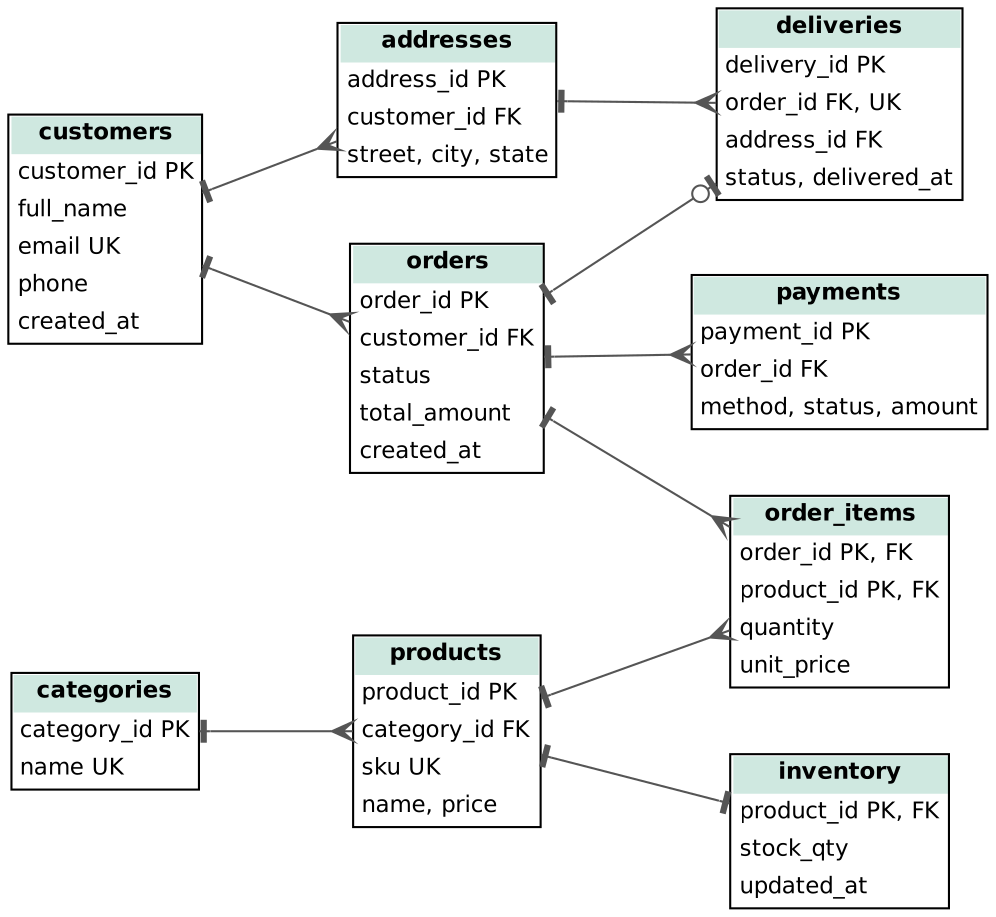
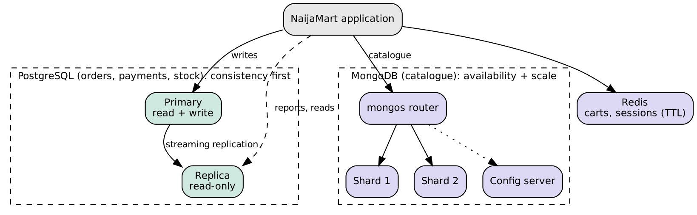

# MIT 8103 Advanced Database Systems

**NaijaMart (simulated Lagos e-commerce platform)** · Deborah Onyebuchi Egonu · Student ID 301915997

GitHub repository: https://github.com/deborahegonu/Egonu_Deborah_Onyebuchi_301915997

## Case study
NaijaMart is a simulated Lagos-based online marketplace. Customers browse products, place orders, pay and track delivery; staff manage stock and sales reports. The database stores customers, addresses, categories, products, inventory, orders, order lines, payments and deliveries. It supports placing orders, updating stock, taking payment, tracking delivery and reporting revenue.

## Portfolio 1: Database design and modelling
I designed nine tables in third normal form. Primary keys identify rows, foreign keys keep the links, and CHECK, UNIQUE and NOT NULL rules enforce prices above zero, non-negative stock, valid statuses and one delivery per order. A partial unique index allows only one pending order per customer. The normalisation notes show a flat order table split through 1NF, 2NF and 3NF. All 14 deliberately invalid inserts were rejected without changing the valid sample rows.

Figure 1. Tables, keys and relationships.

## Portfolio 2: Query processing and optimisation
I wrote four queries (a four-table join, revenue per category, a window-function ranking and an anti-join). On 200,000 synthetic orders, a customer lookup used a parallel sequential scan and took 26.985 ms; after a composite index on (customer_id, created_at) it used a bitmap index scan and took 0.069 ms. A correlated subquery over 600,000 order lines fell from 40,534 ms to 475 ms after indexing order_items.product_id. The cost of indexes is extra storage and slower writes, so I added only indexes that matched real queries.

## Portfolio 3: Transactions and concurrency
A committed order inserted the order and line and reduced stock from 5 to 3 together. A second order for 10 units failed the stock CHECK and was rolled back, leaving the order count and stock unchanged. Two sessions competing for the last unit both accepted an order under the default READ COMMITTED level (a lost update, two orders for one unit). Using `SELECT ... FOR UPDATE`, the second session waited, saw stock 0 and rejected its order.

## Portfolio 4: NoSQL and advanced data models
I modelled the product catalogue as MongoDB documents because products have different attributes, and shopping carts as Redis hashes with a 30-minute expiry. The MongoDB script adds schema validation, compound and nested-field indexes, an aggregation for average rating per category, and an explain plan. Orders, payments and stock remain in PostgreSQL for ACID guarantees.

## Portfolio 5: Distributed and cloud database exercise
The design uses a PostgreSQL primary with a streaming replica, a hash-sharded MongoDB catalogue and Redis. Payments and stock favour consistency; catalogue browsing accepts eventual consistency for availability. Docker Compose files and scripts demonstrate replication and sharding, and the cloud mapping is RDS Multi-AZ with read replicas and MongoDB Atlas.

## Individual technical reflection
{{WRITE_YOUR_OWN_REFLECTION: 150-250 words on design choices, the hardest challenge you solved, what the execution plans taught you, and what you would change.}}

## References
PostgreSQL Global Development Group (2024) *PostgreSQL 16 Documentation*. MongoDB Inc. (2024) *MongoDB Manual*. Redis Ltd. (2024) *Redis Documentation*. Docker Inc. (2024) *Docker Compose documentation*.

## AI use declaration
**Tool:** Claude (Anthropic). **Used for:** drafting the case study structure, SQL and MongoDB scripts, and report text. **Verification:** {{EDIT_TO_MATCH_WHAT_YOU_ACTUALLY_DID: for example, ran every script myself, checked outputs and plans, corrected errors, and wrote my own reflection}}.
