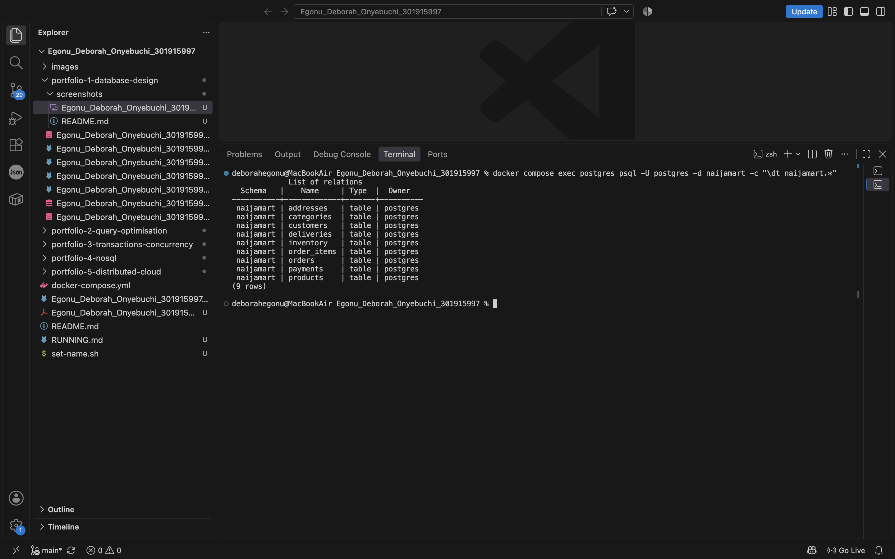
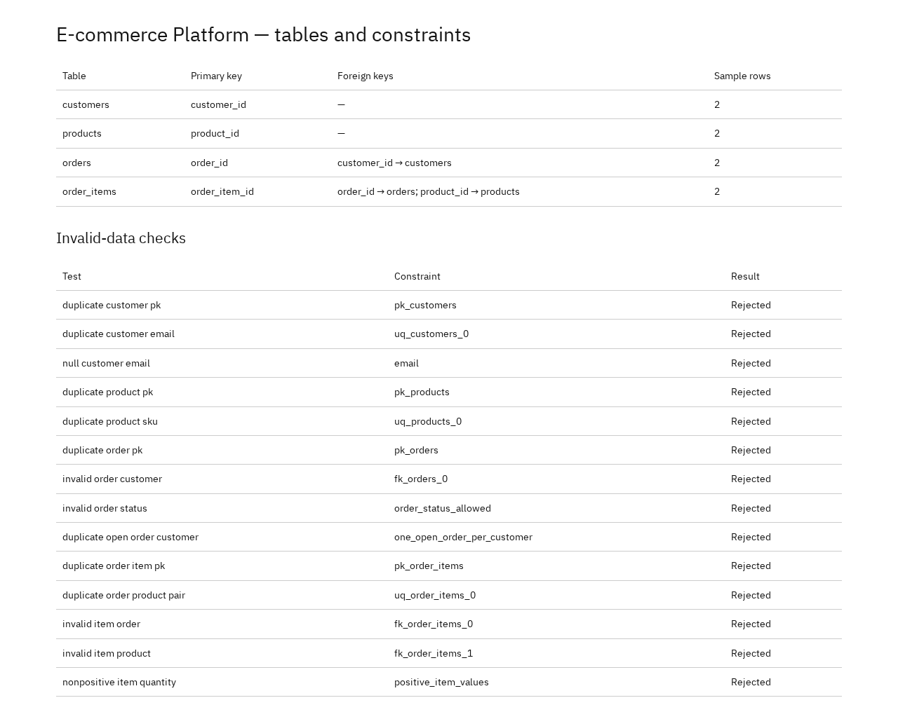
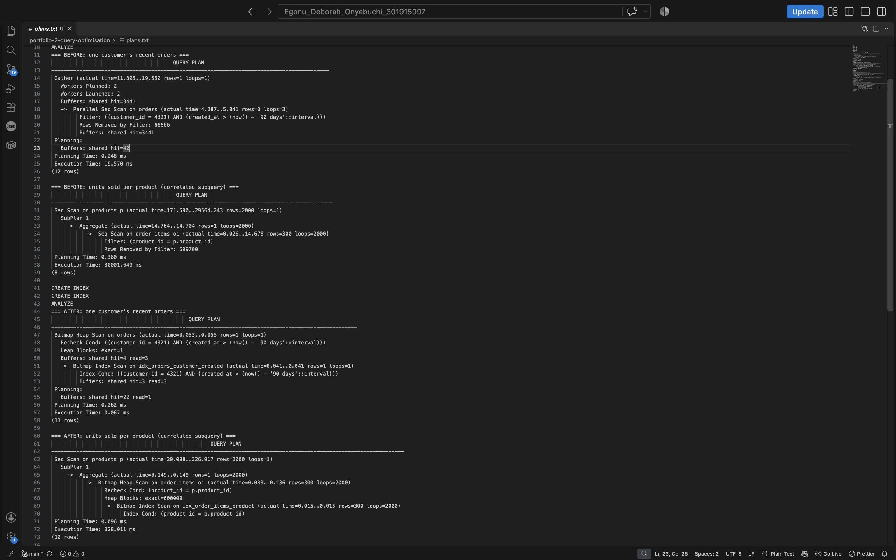
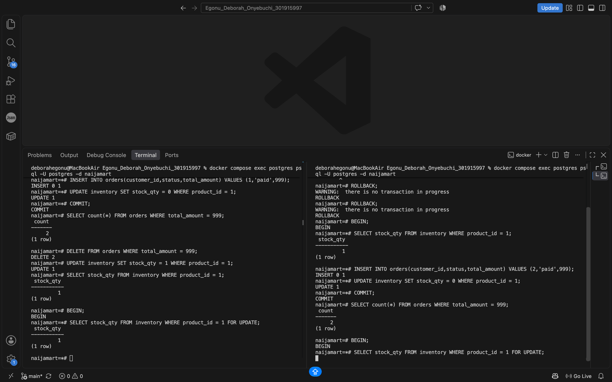
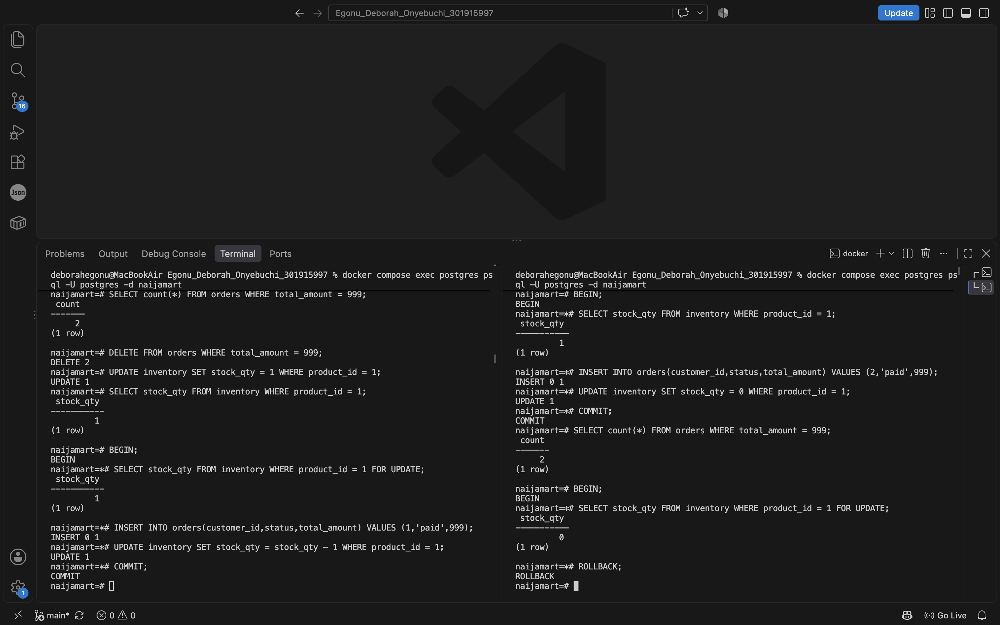
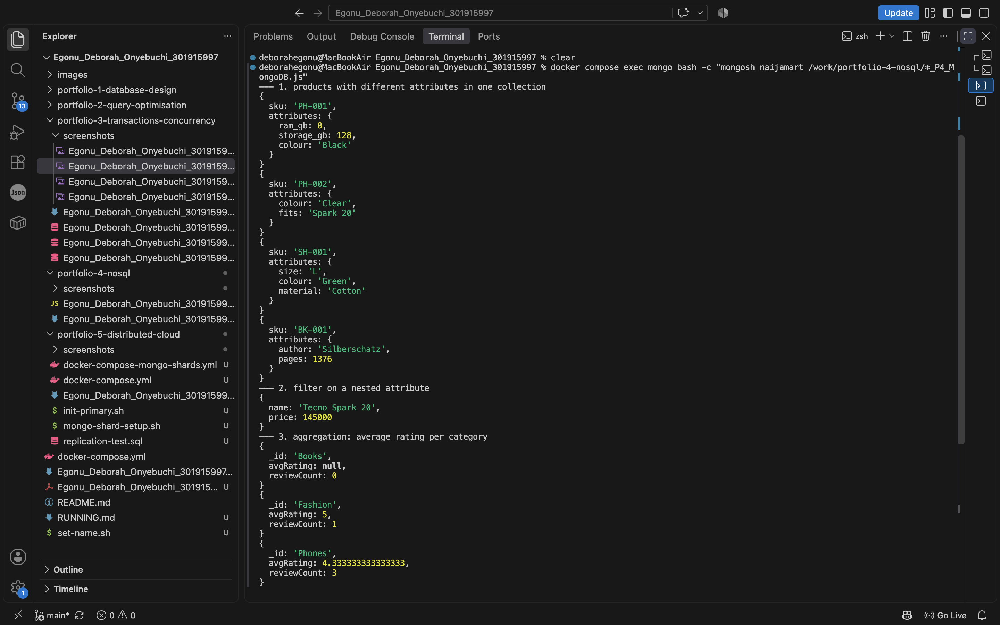
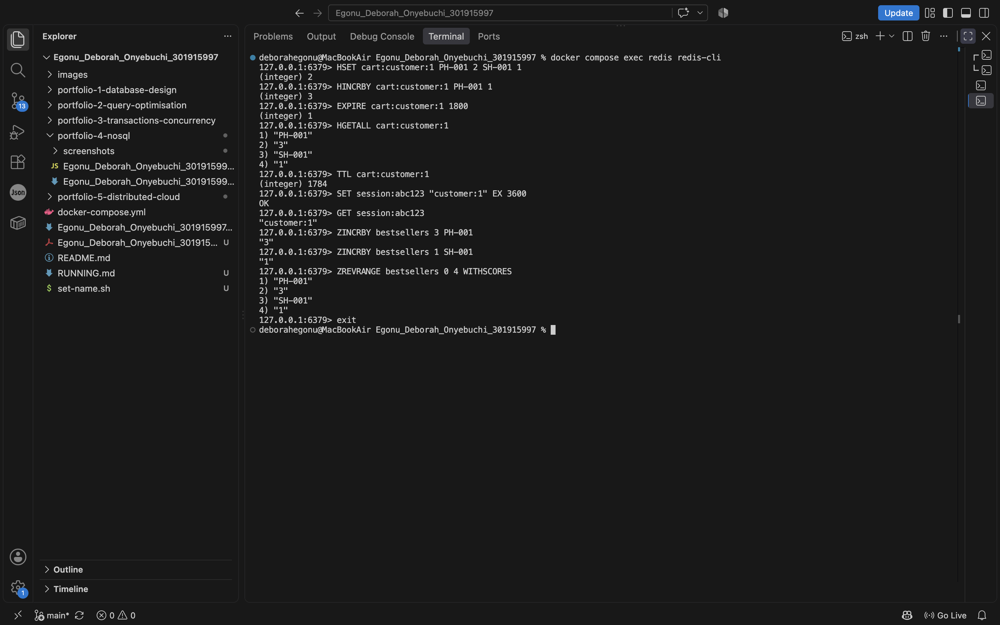
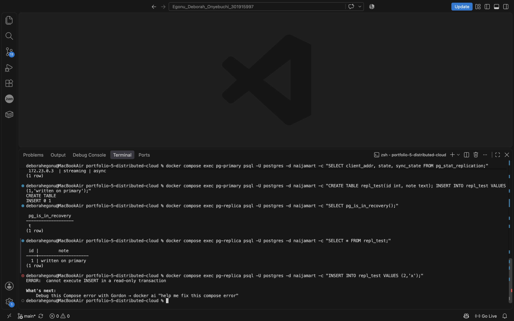
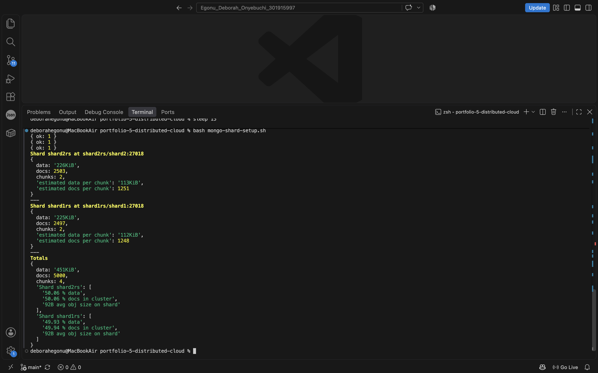

# MIT 8103 Advanced Database Systems

**NaijaMart (simulated Lagos e-commerce platform)** · Deborah Onyebuchi Olisa Egonu · Student ID 301915997

GitHub repository: https://github.com/deborahegonu/Egonu_Deborah_Onyebuchi_301915997

## Case study
Naijamart is a simulated Lagos-based online marketplace (E-commerce platform) where customers can browse products, place orders, pay and track delivery, while staff can manage stock and sales reports. The simulated database stores customers, addresses, categories, products, inventory, orders, order items, payments, and deliveries. It also supports placing orders, updating stock, payment collection, delivery tracking, and reporting revenue.

## Portfolio 1: Database design and modelling
In portfolio 1, I designed the NaijaMart relational database using PostgreSQL. I created nine related tables to manage customers, addresses, products, inventory, orders, order items, payments, deliveries, and product categories. . I used nine tables instead of one because different information belongs to different tables and separating the data accordingly makes the database easier to maintain and scale. I established relationships between tables using primary and foreign keys demonstrated in the ER diagram created in PostgreSQL . I applied constraints such as NOT NULL, UNIQUE, and CHECK to maintain data accuracy and integrity. I also used normalisation to reduce data duplication. Finally, I tested the constraints using the SQL scripts to confirm that invalid records were rejected. 

## Portfolio 2: Query processing and optimisation
In portfolio 2, I wrote four SQL queries to retrieve information from the database. The queries included table joins, revenue per category, customer spend rankings, and identifying products without sales. I generated a large dataset of 200,000 synthetic orders to evaluate query performance. I created indexes on the orders and order_items tables to improve data retrieval speed. I then used EXPLAIN ANALYZE in PostgreSQL to examine the execution plans. The recorded results showed that the recent-orders query improved from 19.570ms to 0.067ms which is a 99.66% increase in retrieval speed. .

## Portfolio 3: Transactions and concurrency
In portfolio 3, I attempted selecting a product that had a stock of 1 unit at the same time in 2 separate sessions to demonstrate the risk of overselling and the importance of transaction management and concurrency control. I first selected a product with a stock of 999 unit and updated it to 1 stock. I then used BEGIN (starts a transaction) , COMMIT (saves the transaction permanently) ,and ROLLBACK (cancels the transaction if anything goes wrong) to demonstrate how database operations can be saved or cancelled. In the two customers selecting 1 product simulation, I used SELECT FOR UPDATE to lock the inventory record during the transaction, ensuring that the second session waited and checked the updated stock before proceeding. 

.

.

## Portfolio 4: NoSQL and advanced data models
In portfolio 4, I explored NoSQL databases such as MongoDB and Redis. I used MongoDB to model the product catalog because different products have different attributes. I implemented product documents, embedded reviews , schema validation, indexes, and aggregation queries . I used Redis to demonstrate temporary scenarios such as shopping cart and session storage which included expiry settings and sorted sets for bestseller rankings.  

## Portfolio 5: Distributed and cloud database exercise
In portfolio 5, I demonstrated 2 distributed database concepts using PostgreSQL and MongoDB. In PostgreSQL, I configured PostgreSQL streaming replication (creating copies of data on other servers) to demonstrate how database changes can be copied from a primary database to a backup or standby 
I also configured a MongoDB sharded-cluster environment (dividing data across servers) with a configuration server, two shards, and a mongos router. I used a hashed SKU shard key to demonstrate data distribution.
 
Finally, I proposed a cloud architecture using Amazon RDS for PostgreSQL and MongoDB Atlas for MondoDB which I generated using Claude AI. 

## Individual technical reflection
I used Docker Desktop to test and complete this project instead of installing individual databases and applications to save my system resources. I am familiar and comfortable with PostgreSQL and MongoDB  but using Redis was a learning experience. I ran into a few challenges while attempting the transactions and concurrency management in PostgreSQL gui. I was able to resolve the issue by moving to my VS code terminal and running the same commands to achieve the concurrency lock wait. I was able to retrace my steps to produce the desired results which enhanced my understanding of transactions and concurrency management. Finally, in portfolio 5, my MongoDB shard members are single-node replica sets because this is a local sharding demonstration, not a production-ready highly available cluster.

## References
PostgreSQL Global Development Group (2024) *PostgreSQL 16 Documentation*. MongoDB Inc. (2024) *MongoDB Manual*. Redis Ltd. (2024) *Redis Documentation*. Docker Inc. (2024) *Docker Compose documentation*.

## AI use declaration
Claude (Anthropic) AI was used to draft the case study, docker-compose.yml files, sample SQL and MongoDB scripts, and the generic technical report texts in each portfolio which I updated with the correct data.

ChatGPT (Open AI) was used to review the completed project files.

I ran every script myself, took screenshots of the checked outputs and plans, corrected errors, and wrote my own reflection, reports, and README.md.

