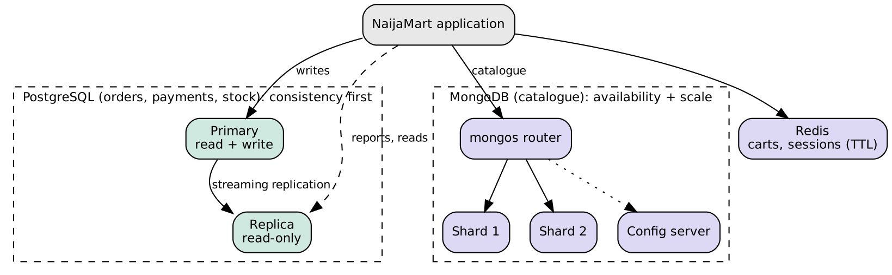

# Portfolio 5: Distributed and cloud database exercise

**NaijaMart (simulated Lagos e-commerce platform)** · Deborah Onyebuchi Egonu · Student ID 301915997



## Design
| Component | Technique | Reason |
|---|---|---|
| PostgreSQL primary + replica | Streaming replication | Reads and reports go to the replica; the replica can be promoted if the primary fails |
| MongoDB catalogue | Hash sharding on `sku` | Spreads catalogue data and traffic evenly across shards |
| Redis | Single node with TTL (cluster in production) | Short-lived carts and sessions |

## Replication (PostgreSQL)
```bash
docker compose up -d
psql -h localhost -p 5432 -U postgres naijamart -f replication-test.sql   # primary part
psql -h localhost -p 5433 -U postgres naijamart                           # replica part
```
Expected evidence: `pg_stat_replication` lists the replica as `streaming`; `pg_is_in_recovery()` is true on the replica; the row inserted on the primary appears on the replica; an insert on the replica fails with "cannot execute INSERT in a read-only transaction".

## Sharding (MongoDB)
```bash
docker compose -f docker-compose-mongo-shards.yml up -d
bash mongo-shard-setup.sh
```
The setup shards `naijamart.products` on `{ sku: "hashed" }` and prints the distribution across the two shards.

## Availability and consistency (CAP)
- **Payments, orders and stock** need consistency. They are written only to the primary. If the network splits, the system should refuse writes rather than risk two versions of a balance (CP).
- **Catalogue browsing** can tolerate slightly stale data. Replicas and shards keep serving reads during failures, and new products appear a moment later (AP, eventual consistency).
- Replica reads can lag behind the primary, so an order confirmation page must read from the primary.

## Cloud deployment
In production this maps to a managed service: Amazon RDS for PostgreSQL with Multi-AZ and read replicas, and MongoDB Atlas with sharding, in an African region (for example AWS Cape Town) to reduce latency for Nigerian users. Automated backups, point-in-time recovery and autoscaling read replicas handle sales peaks such as Black Friday.

## Status
The compose files and scripts have not been run in the environment that generated this repository. Run them and add your screenshots (`screenshots/Egonu_Deborah_Onyebuchi_301915997_P5_Replication.png`, `screenshots/Egonu_Deborah_Onyebuchi_301915997_P5_Sharding.png`), or document a cloud free-tier deployment instead.
